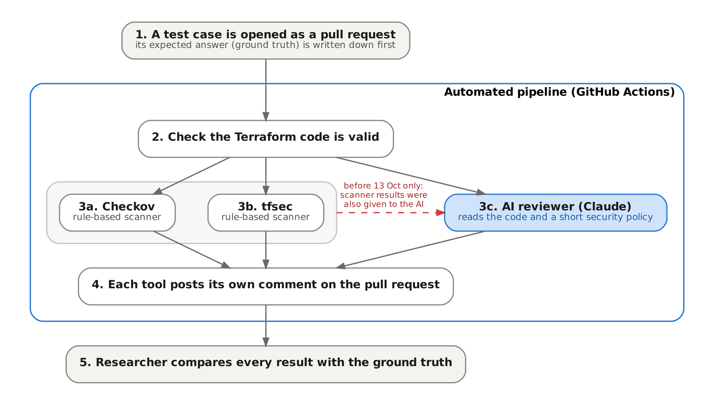

# 3 Practical Research Methodology

## 3.1 Research Design and Methodology

This study uses a controlled experimental comparison with a mixed-methods evaluation. Quantitative measures describe how often each reviewer detected a known security condition and how often it raised findings against acceptable configurations. Qualitative assessment, structured by a predefined rubric, judges whether the AI reviewer's explanations and remediation advice were accurate and usable. The combination follows the evaluation plan set out in Assignment 1 and reflects the view that detection and usefulness must be analysed separately, because a tool may detect accurately yet explain poorly (Creswell and Creswell, 2018).

The design follows the logic of a software engineering experiment (Wohlin et al., 2012). The researcher controls the treatment, a Terraform change with a documented security state. Each reviewer is then applied to the same artefact, and every output is compared with a ground truth fixed before the tools were run. The unit of analysis is the test case. Because the AI reviewer is non-deterministic, each case was also reviewed several times, giving a second, run-level unit of analysis.

The original plan defined three conditions: traditional scanning (Checkov and tfsec), AI-only review and a hybrid of both. In the executed study these conditions were realised in two phases. Between 9 and 12 October 2026 the test cases were run under the workflow default, Condition C, in which normalised Checkov and tfsec findings were inserted into the AI prompt (commit 732083d). Evidence verification on 13 October showed that every AI result from that phase was scanner-informed, so none of it could be reported as AI-only. The workflow was therefore changed (pull request #69, merged on 13 October) so that both scanners and the AI reviewer run in one job without exchanging data. All test cases were then re-run under this independent configuration.

As a result, the AI-only condition is measured directly from the independent runs. The scanner condition comes from the same runs, and the hybrid condition is examined in two forms. The first is the historical scanner-informed runs for TC01–TC12. The second is a decision-level combination of the independent outputs, in which a condition counts as detected when either the scanners or the AI report it. Chapter 4 keeps these forms separate.

## 3.2 System Architecture and Experimental Environment

Figure 3.1 shows the experimental pipeline. Each test case lives on its own branch. Opening a pull request, or dispatching the workflow manually for repeat runs, starts a single GitHub Actions job named "PROM06 Experimental Security Review" on a GitHub-hosted Ubuntu runner.

The job first writes an experiment metadata file recording:

- the experimental condition;
- the commit under test;
- the run identifier;
- the event type;
- whether scanner findings were supplied to the AI.

It then initialises and validates the Terraform without a backend. Checkov, tfsec and the AI review run in turn, three pull-request comments are posted, and all raw outputs are uploaded as a run artefact. The steps execute sequentially, but in the independent configuration no step reads another tool's output.

The pipeline is entirely static. It never runs `terraform plan` or `apply`, so findings describe the configuration, not deployed Azure resources. The environment is summarised in Table 3.1.

Table 3.1: Experimental environment and tool configuration

| Component | Configuration used |
|------------|------------------------------------------|
| CI platform | GitHub Actions, `ubuntu-latest` hosted runner; workflow `.github/workflows/terraform.yml` |
| Infrastructure code | Terraform with AzureRM provider `~> 4.0` (lock file 4.81.0); `terraform init -backend=false`, `fmt -check`, `validate` |
| Checkov | Version 3.3.1, `--framework terraform`, JSON output (secrets framework not run) |
| tfsec | Version 1.28.14, JSON output |
| AI reviewer | Anthropic Claude, model identifier `claude-sonnet-4-6`, Messages API, `max_tokens` 3,000, provider-default temperature, 90 s timeout, two retries |
| AI inputs | `ai/prompt.txt`, `ai/policy.md`, `README.md`, all `terraform/*.tf` files with changed files marked |
| Output handling | JSON schema validation, de-duplication, classification policy v2.2, operational score from `ai/scoring.json` |
| Evidence | Run artefact per run (metadata, raw tool JSON, raw and parsed AI output, rendered comments) |

Two configuration gaps limit reproducibility. Terraform itself was not pinned in the workflow. The AI model identifier is hard-coded in the review runner but is not written to the run metadata.

## 3.3 Technologies and Tools

Terraform was chosen because it is the IaC language used in the Assignment 1 prototype and is widely adopted for multi-cloud provisioning (HashiCorp, 2024). Azure was retained as the target platform for continuity with the existing baseline.

Checkov and tfsec represent the deterministic, rule-based scanners that the literature treats as the established baseline for IaC security (Bridgecrew, 2024; Aqua Security, 2024). Using both allows the study to show that scanners differ from each other as well as from the AI. Both versions were pinned so that scanner behaviour would be stable across runs. tfsec has since been folded into Trivy by its maintainers (Aqua Security, n.d.), which affects how far the tfsec results generalise to current practice.

Anthropic Claude was selected in Assignment 1 as the large language model for the reviewer (Anthropic, 2024). The study evaluates one model and one prompt design. It does not compare models.

## 3.4 Implementation of the AI-Assisted Review Pipeline

The AI reviewer is a Python program (`ai/review_runner.py`) that runs only when the pull request changes at least one Terraform file. It assembles a single prompt from four parts:

- the review instructions;
- a short organisational policy file defining six rules (subnet NSG association, no public DNS, DDoS protection for production only, diagnostic logging, mandatory tags, and no unjustified public exposure);
- the repository README;
- every Terraform file in the configuration, with changed files labelled.

Supplying the complete configuration, not only the diff, was a deliberate design choice so that cross-file conditions such as a missing NSG association could be reasoned about.

The prompt requires a JSON response with at most three findings. Each finding carries a severity, a category and a status: CONFIRMED, NEEDS_CONTEXT, INFORMATIONAL or FALSE_POSITIVE. Only CONFIRMED findings appear in the pull-request comment and reduce the operational score (base 100; −30 for critical or high, −15 for medium, −5 for low). The score maps to APPROVE, APPROVE_WITH_COMMENTS or DO_NOT_MERGE.

The runner validates the response against the schema before posting. In one TC08 run it rejected an output whose policy mapping referred to a finding marked FALSE_POSITIVE, which failed the job. That run is retained as evidence because validation failure is a realistic integration outcome.

The operational score is a pipeline convenience and is not used as a research measure.

Two features of the implementation matter for interpretation. First, the policy file is supplied to the AI but has no equivalent in the scanners. This gives the AI an input advantage for cases that map directly to a policy rule (TC05, TC06, TC08 and TC12). Second, the prompt was refined on the TC01 baseline before the main experiment, so the reviewer was tuned against part of the test material. Both are treated as threats to validity in Chapter 5.

## 3.5 Experimental Design and Test Cases (TC01–TC15)

Twelve test cases were specified before execution in the experimental master plan and ground-truth matrix (Appendix B). Each isolates one Azure misconfiguration or control scenario and includes clean and legitimate cases to test over-reporting.

Three cases were added on 13 October to address weaknesses found while verifying the first twelve:

- **TC13** isolates a least-privilege violation that depends on a separate requirements file. This was needed because TC11 turned out to be detectable from the wildcard role alone, without its intended cross-file reasoning.
- **TC14** is a second negative control. It applies the restricted-source remediation expected for TC02.
- **TC15** places a hard-coded password in a variable default, a more common pattern than the unused local in TC09.

The ground truth for TC13–TC15 was committed (commit cbda52c) before their Terraform fixtures, so these cases meet the same pre-registration rule as the original set. The fifteen cases are listed in Table 3.2.

Table 3.2: Test cases and ground truth

| ID | Category | Terraform condition | Ground truth |
|------|-----------|----------------------------------------|----------|
| TC01 | Control | Secure baseline: NSG with deny-all rules and subnet association, private Log Analytics with NSG diagnostics, Azure-provided DNS | Secure |
| TC02 | Network | Inbound SSH (22) from 0.0.0.0/0 | Vulnerable |
| TC03 | Network | Inbound RDP (3389) from 0.0.0.0/0 | Vulnerable |
| TC04 | Network | Inbound HTTP (80) from 0.0.0.0/0 | Vulnerable |
| TC05 | Network / context | NSG exists but its subnet association is removed | Vulnerable |
| TC06 | Network | VNet uses public resolver 8.8.8.8 | Vulnerable |
| TC07 | Encryption | Storage account `min_tls_version = "TLS1_0"` | Vulnerable |
| TC08 | Logging | NSG diagnostic setting removed | Vulnerable |
| TC09 | Secrets | Dummy credential-shaped string in an unused local | Vulnerable |
| TC10 | IAM | Custom role with `actions = ["*"]` at subscription scope | Vulnerable |
| TC11 | Context | Same wildcard role plus a file documenting two required read actions | Vulnerable |
| TC12 | False positive | Inbound HTTPS (443) from any source, documented as an intended public endpoint | Legitimate |
| TC13 | IAM / context | Contributor at subscription scope; requirements file specifies Reader on the resource group | Vulnerable |
| TC14 | False positive | SSH (22) from a single documentation address, 203.0.113.10/32 | Secure |
| TC15 | Secrets | Hard-coded password as a variable default | Vulnerable |

Each case was built on its own branch from the same main commit. For TC02–TC12, the Terraform under test is byte-identical to the original test-case commits, which was confirmed by comparing the trees. TC01 differs only by one corrected comment.

Each case was opened as a pull request and then dispatched twice more, giving three runs per case. TC08 has four runs because the first run failed validation. This gave 46 independent runs in total.

## 3.6 Ground-Truth Definition and Validation

Ground truth was defined from the Terraform and the documented scenario intent, never from tool output. The ground-truth matrix specifies, for each case:

- the intended security state;
- the affected resources;
- the expected secure configuration;
- the benchmark or policy mapping, where one can be justified.

The wording used here follows the latest revision of the test-case evidence page (version 72), which refined several scenario descriptions after the first runs. Where earlier records conflicted, for example over the TC01 baseline or the TC10 severity, the conflict was resolved against the raw run evidence and the decision recorded (Appendix E).

Outputs were classified with the codes in Table 3.3. Several scanner rules reporting the same condition were normalised to a single detection, so rule counts are never treated as vulnerability counts.

Table 3.3: Classification codes

| Code | Meaning |
|------------|-----------------------------------------|
| TP | Target condition reported (AI: confirmed in every successful run) |
| FN | Target condition not reported |
| PARTIAL | AI raised the target but did not consistently classify it as CONFIRMED |
| TN | No finding against an acceptable configuration (AI: in most runs) |
| FP | Finding against an acceptable configuration |
| CONTEXT | Finding on a property that is intended by design, where acceptability depends on documented context |
| UNVERIFIED | Result cannot be traced to a specific run on the specified fixture |

Individual confirmed AI findings were labelled separately as:

- TARGET, the ground-truth condition;
- EXTRA-VALID, a true issue outside the target;
- DUPLICATE, a restatement of another finding;
- FALSE, a claim that is wrong against the ground truth or the provider schema.

## 3.7 Evaluation Metrics and Scoring Rubric

Detection was measured as the proportion of vulnerable cases classified TP. It is reported both strictly, with PARTIAL counted as a miss, and leniently, with PARTIAL counted as a hit. Over-reporting was measured at two levels:

- **case level:** the number of non-vulnerable cases flagged;
- **run level:** the share of non-vulnerable runs containing at least one confirmed finding.

The precision of the AI's confirmed findings was calculated as (TARGET + EXTRA-VALID) divided by all confirmed findings. These figures describe fifteen constructed cases and are not estimates for any wider population, so no significance testing was attempted.

Explanation and remediation quality were scored on the six-dimension, 0–2 rubric defined in the repository on 8 October, before TC02–TC12 were executed. The dimensions are:

- detection correctness;
- explanation accuracy;
- impact explanation;
- remediation quality;
- context awareness;
- developer usefulness.

The dimensions were fixed in advance. The operational definitions in Table 3.4, which make the scale applicable consistently, were written on 13 October after the outputs had been read. Non-vulnerable cases were scored on detection, explanation and usefulness only.

Table 3.4: Operational scoring rules (summary)

| Dimension | 2 | 1 | 0 |
|--------|--------------|--------------|--------------|
| Detection | Target CONFIRMED on the correct resource | Target only NEEDS_CONTEXT, or partial | Not raised, FALSE_POSITIVE, or run failed |
| Explanation | All technical and policy claims correct | Inaccurate claim or inapplicable policy mapping | Materially wrong |
| Impact | Specific to this configuration | Generic | Missing |
| Remediation | Correct and reaches the secure state | Partial or questionable | Wrong or absent |
| Context | Correct cross-resource reasoning | Incomplete | Ignores relevant context |
| Usefulness | Actionable comment with no noise | Extra false or duplicate confirmed findings | Misleading, target hidden, or legitimate change blocked |

Scores for all 46 runs were produced by an AI research assistant applying these rules, with every score and its written justification recorded alongside the evidence (Appendix E). No second independent rater was used, so the scores reflect a single rubric application. Chapter 5 treats this as a limitation.

Remediation effectiveness, the master plan's demonstrated correction rate, was tested directly. For each case the AI detected, the recommendation from the first run that confirmed the target was applied to the unchanged fixture on a new branch, with no other edits. Where the AI gave only a placeholder source range, the documentation address 203.0.113.10/32 was used. Each remediation branch was opened as a pull request so that validation, both scanners and a fresh AI review ran on it. Two further variants isolated specific effects:

- the stale fixture comment was corrected while the fix was left unchanged;
- a recommendation attached to a false AI finding was applied as written.

Timing was taken from GitHub step timestamps, which have one-second resolution. Because all comments are posted together at the end of the job, time to feedback is the same for every tool. The study therefore reports each tool's step duration and the overall pull-request-to-comment latency, not separate detection times.

## 3.8 Data Collection and Analysis Procedure

For every run, the run artefact provided the evidence:

- experiment metadata;
- raw Checkov and tfsec JSON;
- the raw model response;
- the parsed AI output;
- the rendered comments.

Pull-request comments and job timings were retrieved through the GitHub API. Before any result was used, the metadata of all 46 runs was checked to confirm the independent condition, the commit under test and that no scanner findings had been supplied to the AI. Scanner results were also reproduced locally with the same tool versions, and they matched the pipeline outputs in every case.

Analysis then proceeded in a fixed order:

1. Classify each tool's output against the ground truth.
2. Normalise overlapping scanner rules.
3. Label every confirmed AI finding.
4. Score the AI output against the rubric.
5. Compute the metrics.

Spreadsheet formulas, not hand totals, produce every reported figure. A claim register links each statement in Chapter 4 to its run identifier, commit or file. All raw evidence is preserved unchanged on a dedicated repository branch (Appendices D–F).

## 3.9 Reproducibility, Reliability and Research Ethics

Scanner results were identical across repeated runs and matched the local reproduction, so the scanner condition is reproducible with the pinned versions. The AI condition is not. With no temperature set, identical inputs produced different findings, severities and classifications, a behaviour documented for large language models in code tasks (Ouyang et al., 2025). Three runs per case show this variation but cannot estimate its rate with any precision. The unpinned Terraform version and the unrecorded model identifier in run metadata further limit exact replication. Prompt and policy files are versioned in the repository, so the review instructions for every run can be recovered from its commit.

The study involved no human participants and no personal data. All infrastructure was synthetic. Secrets were dummy values created for the purpose, and addresses came from the RFC 5737 documentation range (Arkko, Cotton and Vegoda, 2010). No test case was merged or deployed, so no vulnerable resource was ever exposed. Only synthetic Terraform was sent to the external AI service.

Formal ethics approval was not required, because the study involved no human participants and no personal data. In line with the module's guidance on artificial intelligence, generative AI was used in two ways. It was the object of study, and it also acted as a research assistant for evidence verification, scoring and drafting. All AI-assisted outputs were checked against the primary evidence before use.

The evidence register and the archived raw outputs allow every reported figure to be checked independently of that assistance.

## References cited in this chapter

Anthropic (2024) *Claude Documentation*. Available at: https://docs.anthropic.com/ (Accessed: 23 July 2026).

Aqua Security (2024) *tfsec Documentation*. Available at: https://aquasecurity.github.io/tfsec/ (Accessed: 23 July 2026).

Aqua Security (n.d.) *tfsec* [GitHub repository]. Available at: https://github.com/aquasecurity/tfsec (Accessed: 13 October 2026).

Arkko, J., Cotton, M. and Vegoda, L. (2010) *IPv4 Address Blocks Reserved for Documentation*. RFC 5737. Internet Engineering Task Force. Available at: https://www.rfc-editor.org/rfc/rfc5737 (Accessed: 13 October 2026).

Bridgecrew (2024) *Checkov Documentation*. Available at: https://www.checkov.io/ (Accessed: 23 July 2026).

Creswell, J.W. and Creswell, J.D. (2018) *Research Design: Qualitative, Quantitative, and Mixed Methods Approaches*. 5th edn. Thousand Oaks, CA: SAGE.

HashiCorp (2024) *Terraform Documentation*. Available at: https://developer.hashicorp.com/terraform/docs (Accessed: 23 July 2026).

Ouyang, S., Zhang, J.M., Harman, M. and Wang, M. (2025) 'An empirical study of the non-determinism of ChatGPT in code generation', *ACM Transactions on Software Engineering and Methodology*, 34(2).

Wohlin, C., Runeson, P., Höst, M., Ohlsson, M.C., Regnell, B. and Wesslén, A. (2012) *Experimentation in Software Engineering*. Berlin: Springer.
