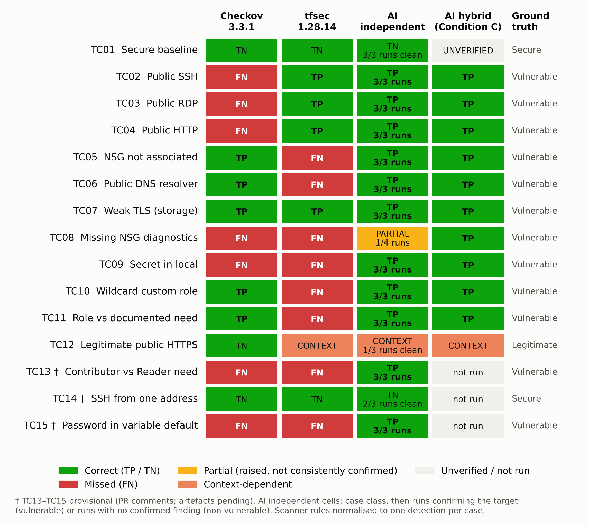
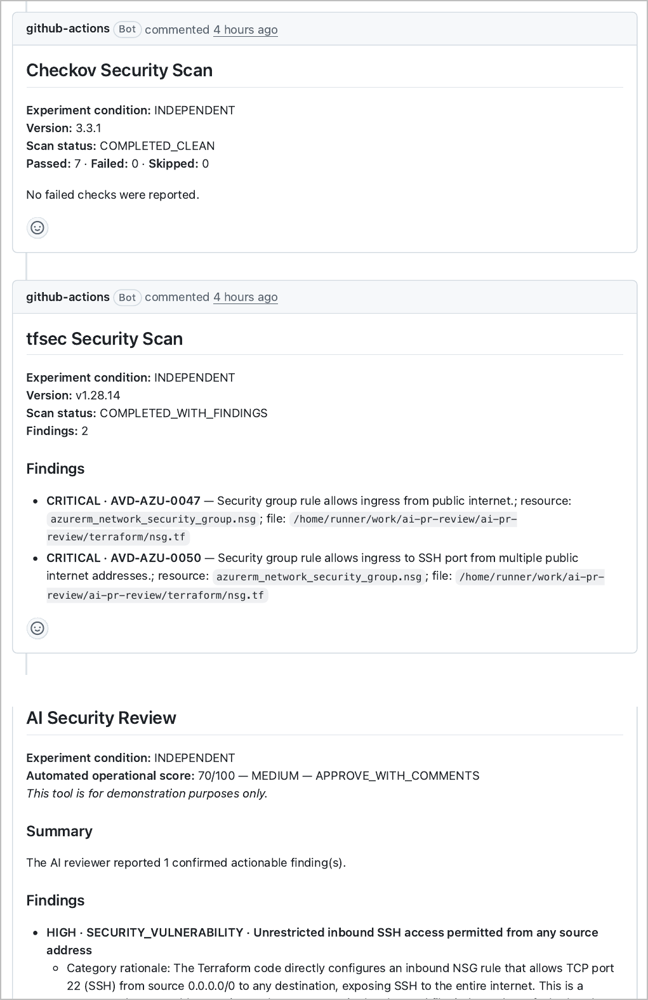
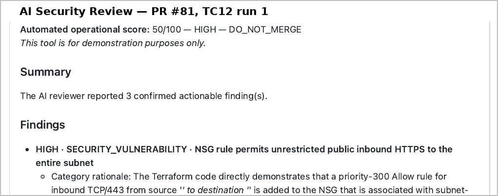
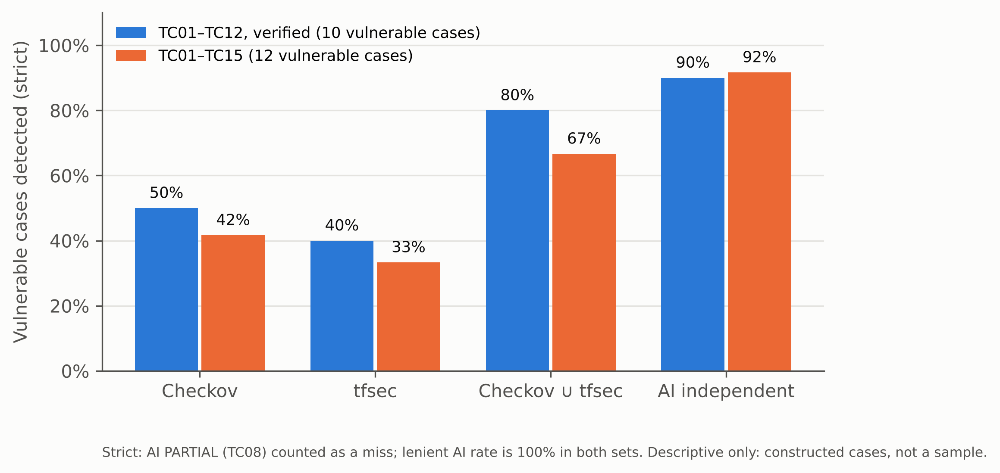
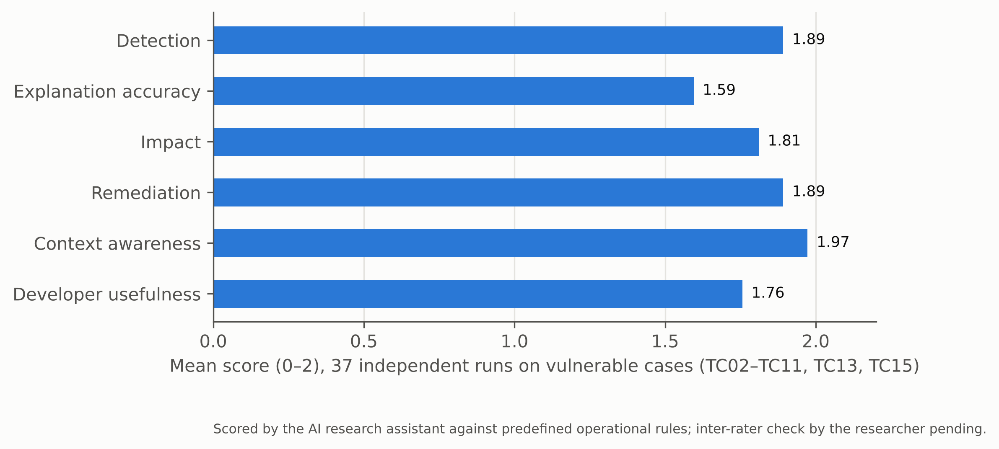
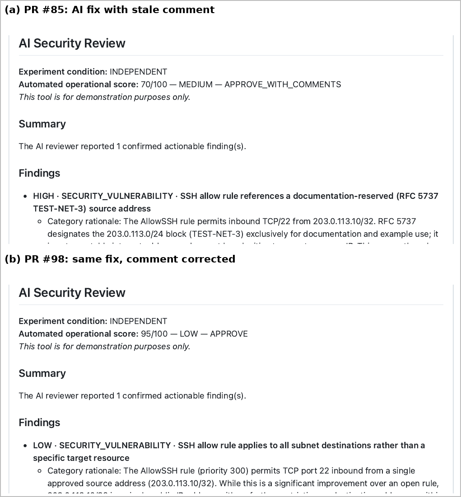
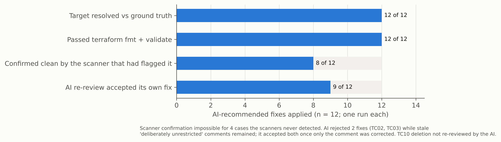
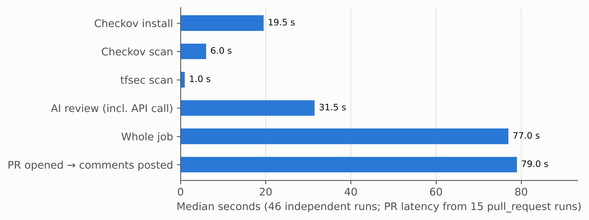

# 4 Analysis of Results

## 4.1 Introduction

This chapter reports what the scanners and the AI reviewer actually produced on the fifteen test cases and evaluates those outputs against the ground truth defined in Chapter 3. Results come from the 46 independent runs unless stated otherwise. The earlier scanner-informed (Condition C) runs are used only in Section 4.4, and are labelled as such.

The figures describe fifteen deliberately constructed cases. They show how these tools behaved on these configurations and are not estimates of performance in general. Every figure is traceable to a run identifier, commit or file (Appendix E).

Figure 4.1 summarises the case-level outcome for every tool.

## 4.2 Results from Traditional Scanning (Checkov and tfsec)

Both scanners produced identical output in every repeated run, and their results matched a local reproduction with the same versions. Checkov detected 5 of the 12 vulnerable cases (TC05, TC06, TC07, TC10, TC11), and tfsec detected 4 (TC02, TC03, TC04, TC07). Together they detected 8. Only TC07, the weak TLS setting, was found by both. Their coverage was therefore almost entirely complementary, not overlapping.

### Checkov's misses on public network rules

The most instructive scanner result is Checkov's silence on TC02–TC04. Its rules for public SSH, RDP and HTTP exposure (CKV_AZURE_10, CKV_AZURE_9 and CKV_AZURE_160) were evaluated and passed for rules whose source was `0.0.0.0/0`. When the source in TC02 was changed to `*` and nothing else, CKV_AZURE_10 failed. The miss is therefore a value-matching limitation in the rule, not a configuration error, and it means that two equivalent ways of writing "the whole internet" receive different verdicts. Figure 4.2 shows the TC02 pull request as a developer saw it.

### tfsec's silence outside network exposure

tfsec produced no finding for TC05, TC06, TC08, TC10, TC11 or TC13. These cover:

- subnet–NSG association;
- VNet DNS servers;
- custom role definitions and role assignments;
- diagnostic settings.

Its detections in this study were confined to network exposure and storage encryption, which suggests these misses reflect the scope of its rule set, not a fault in this configuration.

### Cases neither scanner detected

Neither scanner detected:

- the missing NSG diagnostic setting (TC08);
- either embedded secret (TC09, TC15);
- the over-privileged role assignment in TC13. That assignment uses the built-in Contributor role, so no wildcard rule fires.

For the secrets, the result partly reflects the study's configuration. Checkov was run with its Terraform framework only. A follow-up run of its secrets framework flagged the TC09 string as a high-entropy value (CKV_SECRET_6) but did not flag the readable password in TC15. Entropy-based detection catches random-looking strings, not secrets that look like ordinary words.

### False alarms and noise

On the non-vulnerable cases the scanners were quiet except for one disputed alert. tfsec reported TC12's intended public HTTPS rule as CRITICAL. This is classified as CONTEXT: the rule is accurate about the configuration but cannot know that the exposure is intended.

Checkov produced the most noise on TC07. Ten failed checks unrelated to TLS appeared alongside the relevant one (CKV_AZURE_44), which illustrates why raw check counts cannot be read as vulnerability counts.

## 4.3 Results from AI-Only Review

### Detection

Independently of the scanners, the AI reviewer confirmed the target condition in all runs of 11 of the 12 vulnerable cases. Across vulnerable-case runs, it confirmed the target in 34 of 37.

The exception was TC08. In all four runs the AI identified the missing NSG diagnostic setting, explained why it mattered and recommended the correct resource. It classified the finding differently each time:

- **once as FALSE_POSITIVE,** an output the runner rejected, so the job failed;
- **twice as NEEDS_CONTEXT,** a status that is hidden from the pull-request comment;
- **once as CONFIRMED.**

The developer would therefore have seen the finding in one run out of four. This is recorded as PARTIAL: the model noticed the problem but its classification step was unstable, so it was not a detection miss.

### AI-only detections

Three cases were detected by the AI and by neither scanner: TC09, TC13 and TC15.

TC13 is the clearest evidence of contextual reasoning in the study. In all three runs the AI found the Contributor assignment at subscription scope by comparing it with the separate requirements file. It also recommended exactly the Reader role at resource-group scope.

TC11 was intended to test the same ability but proved weaker evidence. Its wildcard role is detectable without the requirements file, as Checkov showed.

None of the three AI-only detections depended on the policy file supplied to the AI, which strengthens their weight. The cases that did map to a policy rule (TC05, TC06, TC08) cannot be attributed to model reasoning alone.

### Over-reporting

On the non-vulnerable cases the AI was less reliable:

- **TC01:** clean in all three runs.
- **TC12:** one run blocked the legitimate HTTPS change (score 50, DO_NOT_MERGE; Figure 4.3), one raised a LOW tagging finding, and one was clean.
- **TC14:** the restricted SSH rule was accepted in two runs. One run confirmed a LOW finding about its wildcard destination, which the ground truth does not treat as a defect.

At run level, 3 of 9 non-vulnerable runs carried at least one confirmed finding.

### Precision of confirmed findings

Table 4.1 shows how the AI's 45 confirmed findings divide.

Table 4.1: AI confirmed findings across 46 independent runs

| Label | Count | Examples |
|------------|------|------------------------------------------------|
| TARGET | 34 | Ground-truth condition in TC02–TC11, TC13, TC15 |
| EXTRA-VALID | 3 | Missing mandatory tags on the TC07 storage account |
| DUPLICATE | 1 | TC03 run 3 restated public RDP as a policy finding |
| FALSE | 7 | Tags required on `azurerm_role_definition` (TC10 ×2) and `azurerm_network_security_rule` (TC12 ×2); TC12 HTTPS treated as a defect (×2); TC14 destination scope |
| Total | 45 | Precision (TARGET + EXTRA-VALID) / total = 82% |

### Sensitivity to the design of the negative controls

Three of the seven false findings need qualification. Both negative controls added their allow rule to the network security group shared by the whole subnet, with a wildcard destination (`destination_address_prefix = "*"`). The TC12 rule therefore exposes port 443 on every host in the subnet, not on a single web endpoint, and the TC14 rule does the same for SSH. The ground truth, fixed before execution, considered only the source of each rule, and Table 4.1 follows it.

However, the two TC12 findings that called the exposure broader than its documented justification, and the TC14 finding about the wildcard destination, describe the configuration accurately. They point to a weakness in the test fixtures, not an invented one.

If these three findings are treated as valid, false findings fall from 7 to 4 and precision rises from 82% to 89% (40 of 45). Two of the nine non-vulnerable runs would then carry a false finding instead of three. The four remaining false findings are all claims that resources which cannot be tagged must carry tags. The classification in Table 4.1 is kept because changing the ground truth after seeing the results would weaken the study more than the flaw does. tfsec's TC12 alert is unaffected, because its rule concerns the public source of the traffic, not its destination.

## 4.4 Results from the Hybrid Approach

The hybrid condition is examined in two forms, which must not be merged.

### Scanner-informed runs (Condition C)

In the scanner-informed runs of 9–12 October, the AI detected all ten vulnerable cases in TC01–TC12, including TC08, and its comments cited the scanner rule identifiers. The TC01 result from that phase cannot be tied to a run on the final baseline and is unverified.

The severities were higher than in the independent runs: CRITICAL rather than HIGH for TC02, TC03 and TC07, matching the CRITICAL labels attached by tfsec. A plausible reading is that the scanner evidence anchored the AI's severity. However, prompt, fixture state and timing also differed between the phases, so the effect cannot be isolated. Most Condition C cases ran only once, so the TC08 detection may equally reflect run-to-run variation, as the independent runs suggest.

### Decision-level combination

The second form is a combination of the independent outputs, reporting a condition when either the scanners or the AI do. It detected 11 of the 12 vulnerable cases. Only TC08 was missed, and only if PARTIAL is counted as a miss.

No condition was found by a scanner and missed by the AI. Within this set, the AI therefore covered everything the scanners covered plus three cases they did not.

The combination also inherits both sources of false alarm. These are tfsec's alert on TC12 and the AI's run-level findings on TC12 and TC14.

## 4.5 Comparative Analysis Across TC01–TC15

Figure 4.4 compares detection rates. On the twelve verified original cases the scanners together reached 80% and the AI 90%. On all fifteen cases the scanners together reached 67% and the AI 92% (100% if PARTIAL counts).

The gap widened when the three later cases were added, because all three targeted conditions without a scanner rule. This illustrates how strongly such comparisons depend on case selection. The AI's apparent advantage is concentrated in conditions that are contextual (TC13), semantic (TC15) or outside the scanners' rule sets (TC08, TC09). Neither the scanners nor the AI is uniformly stronger: tfsec found the public network rules that Checkov missed, and Checkov found the association, DNS and role conditions that tfsec has no rules for.

Table 4.2: Summary of detection and false-alarm measures

| Measure | Checkov | tfsec | Checkov ∪ tfsec | AI independent |
|------------------------------|------|------|--------|----------|
| Vulnerable cases detected, TC01–TC12 (n = 10) | 5 | 4 | 8 | 9 (+1 partial) |
| Vulnerable cases detected, TC01–TC15 (n = 12) | 5 | 4 | 8 | 11 (+1 partial) |
| Non-vulnerable cases flagged (n = 3) | 0 | 1 (TC12) | 1 | 1 (TC12) |
| Non-vulnerable runs with a confirmed finding | — | — | — | 3 of 9 |
| Deterministic across repeated runs | Yes | Yes | Yes | No |

## 4.6 Detection Accuracy and False Positives

The scanners' errors were omissions, and those omissions were stable. A missing rule or a narrow match fails the same way every time, which makes it predictable and fixable.

The AI's errors were of a different kind:

- **inconsistent classification,** as in TC08;
- **over-reporting on acceptable configurations,** as in TC12 and TC14, although part of this reflects the fixtures' wildcard destinations (Section 4.3);
- **false claims about the platform.**

The most telling false claims concerned tags. In TC10 and TC12 the AI asserted that resources which cannot be tagged must carry mandatory tags. In a later run of TC12 it correctly stated the opposite. Applying its TC10 recommendation as written made `terraform validate` fail with "An argument named "tags" is not expected here".

Run-to-run variation affected severity as well as detection. TC05 was rated HIGH twice and MEDIUM once on identical input. TC10 gained or lost an extra finding between runs. A pipeline gate based on the AI's score would therefore have produced different merge decisions for the same change.

## 4.7 Remediation Quality and Contextual Accuracy

### Rubric scores

Figure 4.5 summarises the rubric scores. Over the 37 vulnerable-case runs the AI averaged 1.89 out of 2 for detection, remediation and impact. Context awareness averaged 1.97 and developer usefulness 1.76. Explanation accuracy was lowest at 1.65. Eighteen of the 37 runs scored full marks on every dimension.

The explanation errors fell into three groups:

- **Inapplicable policy mapping.** Nine runs mapped a finding to the "no public exposure" rule when the issue concerned identity, encryption or secrets. This happened partly because the supplied policy file had no rule for those topics.
- **False platform claims.** These included the tag claims above. In two TC13 runs the AI also asserted that Contributor can change role assignments, which Microsoft's role definition explicitly excludes (Microsoft, n.d.).
- **One unconditional misstatement.** In one TC09 run the AI said an unreferenced local value was already present in Terraform state.

Conditional statements that secrets in configuration may reach state were not penalised, because the vendor documentation makes the same general point (HashiCorp, n.d.).

Remediation was usually specific and correct. The main gap was TC04, where all three runs restricted the source address but never mentioned that HTTP is unencrypted or proposed HTTPS.

These scores come from a single application of the rubric by an AI assistant, so they have no independent reliability check. Their value lies in the recorded justification for each score, which can be audited against the evidence, more than in the averages themselves.

### Remediation validation

Applying the AI's own recommendations tested whether its advice achieves the secure state (Table 4.3; Figure 4.7). All twelve fixes resolved the target condition against the ground truth and passed formatting and validation. In eight cases the scanner that had flagged the issue confirmed the fix. The other four were cases no scanner could see, so only the ground truth could confirm them.

The fresh AI review accepted nine of its own fixes. Two of the rest are revealing:

- **TC07.** The TLS issue disappeared, but the AI then blocked the change over three other storage settings, one of which it had previously classified as needing context.
- **TC02 and TC03.** The AI rejected its own fixes with HIGH findings. Both reviews quoted the unchanged fixture comment "Deliberately unrestricted…". When only that comment was corrected, TC03 passed cleanly and TC02 received a LOW note. With its comment corrected, TC04 drew a new MEDIUM finding about cleartext HTTP, an issue the AI had not raised when reviewing the original fixture. Figure 4.6 shows the TC02 pair.

The third case was never re-reviewed: TC10's fix deleted a file, and the runner skips the AI step when a pull request changes no Terraform file.

Table 4.3: Remediation validation (one review per fix)

| Case | AI fix applied | Target resolved | Confirmed by scanner | AI re-review |
|--------|----------------------|----------|----------|--------------------------|
| TC02 | Source restricted to one address | Yes | tfsec | HIGH (stale comment); LOW once corrected |
| TC03 | Source restricted to one address | Yes | tfsec | HIGH (stale comment); clean once corrected |
| TC04 | Source restricted to one address | Yes | tfsec | LOW; MEDIUM "use HTTPS" once corrected |
| TC05 | Subnet–NSG association added | Yes | Checkov | Clean |
| TC06 | Public DNS removed | Yes | Checkov | Clean |
| TC07 | Minimum TLS 1.2 | Yes | Checkov, tfsec | Blocked on other storage findings |
| TC08 | NSG diagnostic setting added | Yes | n/a | Clean |
| TC09 | Hard-coded local removed | Yes | n/a | Clean |
| TC10 | Wildcard role deleted | Yes | Checkov | Not invoked (deletion only) |
| TC11 | Two documented read actions; resource-group scope | Yes | Checkov | Clean |
| TC13 | Reader at resource-group scope | Yes | n/a | Clean |
| TC15 | Default removed; `sensitive = true` | Yes | n/a | LOW (no validation block) |
| TC10 (tags) | Tags added to role definition | Invalid — validate failed | — | Not run |

### Comments as evidence

These results expose a finding the study did not set out to measure: the AI treats natural-language comments in the code as evidence. Four observations support this:

- the stale comments altered the re-review verdicts;
- every TC05 run raised a context note about an outdated DNS comment;
- the rejected TC08 run cited a comment as proof that the omission was intentional;
- the clean TC12 run quoted a fixture comment beginning "Ground truth:".

This is useful when comments are accurate. It also means that comments can lower or raise the AI's verdict independently of the configuration they describe.

## 4.8 Execution Time and Operational Performance

Figure 4.8 shows median step durations across the 46 runs:

| Step | Median duration |
|--------------------------|--------------------------|
| AI review | 31.5 s (range 18–131 s) |
| Checkov scan | 6 s, plus 19.5 s to install |
| tfsec | about 1 s |
| Whole job | 77 s |
| Pull request opened to comments posted | 79 s |

The AI step accounted for about 41% of job time and was the only step whose duration varied widely, because it depends on an external service. For a pull-request workflow these times are small. Feedback arrived in under two minutes in every pull-request run. Cost and API availability, which the study did not measure, are the more relevant operational constraints.

## 4.9 Discussion Against the Research Questions and Existing Literature

### Detection accuracy

On these cases the AI detected more conditions than either scanner, and every condition the scanners found. Its added detections came from context and semantics, not from better coverage of the scanners' own rule types.

The scanners' failures were predictable gaps. The AI's were inconsistent behaviour and over-reporting. That contrast matters because false alarms and opaque results are a known reason developers stop trusting analysis tools (Johnson et al., 2013). A reviewer that blocks a legitimate change in one run and accepts it in the next adds a new form of that problem.

### Remediation quality

The AI's advice was mostly correct and sufficient to reach the secure state, which the remediation tests demonstrate rather than assume. However, its explanations contained confident false statements about the platform, consistent with the hallucination problem described for language models (Ji et al., 2023). One such statement produced invalid Terraform when followed.

### Integration challenges

The practical challenges observed were concrete:

- variation between identical runs (Ouyang et al., 2025);
- classification states that hide real findings from developers;
- validation failures;
- a review step skipped for deletion-only changes;
- sensitivity to comments.

The last of these connects directly to indirect prompt injection, where text placed in data the model reads alters its behaviour (Greshake et al., 2023). In a pull-request reviewer the code under review is exactly such data.

### Developer understanding

The study did not measure developer understanding directly, as no developers took part. The usefulness scores are a proxy judged by the researcher.

### Overall

Taken together, the evidence supports using the AI reviewer alongside deterministic scanners, not instead of them. It also argues for treating the AI's verdict as advisory, not as a merge gate.

## References cited in this chapter

Greshake, K., Abdelnabi, S., Mishra, S., Endres, C., Holz, T. and Fritz, M. (2023) 'Not what you've signed up for: Compromising real-world LLM-integrated applications with indirect prompt injection', *Proceedings of the 16th ACM Workshop on Artificial Intelligence and Security (AISec '23)*. New York: ACM, pp. 79–90. doi:10.1145/3605764.3623985.

HashiCorp (n.d.) *Manage sensitive data in your configuration*. Available at: https://developer.hashicorp.com/terraform/language/manage-sensitive-data (Accessed: 13 October 2026).

Ji, Z., Lee, N., Frieske, R., Yu, T., Su, D., Xu, Y., Ishii, E., Bang, Y., Madotto, A. and Fung, P. (2023) 'Survey of hallucination in natural language generation', *ACM Computing Surveys*, 55(12), pp. 1–38. doi:10.1145/3571730.

Johnson, B., Song, Y., Murphy-Hill, E. and Bowdidge, R. (2013) 'Why don't software developers use static analysis tools to find bugs?', *Proceedings of the 35th International Conference on Software Engineering (ICSE)*, pp. 672–681. doi:10.1109/ICSE.2013.6606613.

Microsoft (n.d.) *Azure built-in roles for Privileged*. Available at: https://learn.microsoft.com/en-us/azure/role-based-access-control/built-in-roles/privileged (Accessed: 13 October 2026).

Ouyang, S., Zhang, J.M., Harman, M. and Wang, M. (2025) 'An empirical study of the non-determinism of ChatGPT in code generation', *ACM Transactions on Software Engineering and Methodology*, 34(2).
